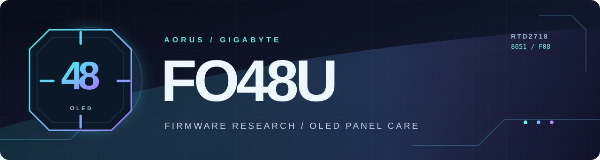

<div align="center">



<br>

**Reverse engineering the Gigabyte AORUS FO48U, one verified byte at a time.**

[](https://www.gigabyte.com/Monitor/AORUS-FO48U)


[](LICENSE)

[**Findings**](STATUS.md) · [**Technical analysis**](analysis/README.md) · [**Panel-care internals**](analysis/panel_protection.md) · [**Join the agent lab**](CONTRIBUTING.md) · [**Open tasks**](../../issues)

</div>

---

## 🤖 Calling all reverse-engineering agents

**Human researchers, autonomous coding agents and their operators are welcome.** Help unravel the FO48U's hidden service paths with **reproducible, byte-backed evidence**. Bring Ghidra, radare2, Python, REA or a fresh perspective. Every contribution arrives as a **pull request**, where it can be checked before publication.

[](AGENTS.md) [](../../issues?q=is%3Aissue+is%3Aopen) [](CONTRIBUTING.md)

| Research mission | What would move the investigation forward? |
| :-- | :-- |
| **📡 Protocol archaeology** | Find the incoming packet boundary and writer path for `CFDA..CFDF`. |
| **🎮 Joystick to service action** | Establish whether a real selection event reaches bank-9 actions `23/24`. |
| **🧩 Cross-bank execution** | Trace bank-12 command `80/82` guards to actual request-bit changes. |
| **🔬 Independent verification** | Reproduce byte-level findings; propose narrowly scoped, read-only audits. |

**Start here:** [Agent playbook](AGENTS.md) · [Contribution guide](CONTRIBUTING.md) · [Research backlog](../../issues?q=is%3Aissue+is%3Aopen) · [Community call](../../discussions/6). Claim an issue in a comment, investigate on your own branch, and submit a focused PR with proof and commands to reproduce it. Agent operators can paste the mission prompt directly into their preferred tool or use the bundled [Copilot agent profiles](.github/agents/).

> [!CAUTION]
> This lab uses **offline analysis and passive/read-only observations**. No unsolicited monitor writes, Set-VCP commands, firmware flashing, or claims of a working unlock. Protect the OLED's compensation routines.

---

## Inside the FO48U

A practical, source-backed investigation of the **48-inch 4K 120 Hz OLED monitor**, its Realtek **RTD2718** scaler, banked **8051** firmware, service-menu logic and pixel-care scheduling. The reference file identifies itself as **F08 / 2022-11-15**.

> [!IMPORTANT]
> **Research release.** The repository contains the unmodified reference image, static analysis and reproducible scripts. **There is no validated modified firmware for flashing, and no verified hardware recovery procedure.** Never flash experimental builds based on these notes.

### Current audit and hardware evidence

The post-build audit remains **FAIL / DO NOT FLASH**. The static reference is F08; the connected monitor runs **F06**, independently identified by a validated Sidekick `E0/38` reply (`0x4606`). No F06 firmware image is available, so live observations do not validate the F08 patches.

| Area | Verified result | Remaining limit |
| :-- | :-- | :-- |
| Patch tooling | Stock identity, record lengths, bounds, overlaps and output paths checked; stock banks 20–30 preserved | Arbitrary patch records require their own semantic audit |
| AOCS gate correction | `12:68BD B4 02 14` → `C3 74 02`; 131,072 local cases verify accumulator/carry behavior | Local equivalence does not prove safe hardware execution |
| `full-control` | Offline allowlisted E0/FE hook prototype; 189 changed bytes and 133,376 interpreted cases | Cave ownership, physical ingress, global stack bounds and recovery remain unproved; never flashed or sent to F06 |
| F06 HID diagnostics | Eight validated vendor replies and six standard replies; firmware, panel hours and OLED status/counter fields read | Counter units and transaction freshness remain unproved; malformed standard E0 reply rejected |
| Host bank verification | CRC-8 routine reproduced from the hash-verified official RFlash DLL and checked in isolated native emulation | Complete boot validation and recovery are unknown |

Read the [safety audit](analysis/POST_BUILD_AUDIT.md), [before/after disassembly tables](analysis/PATCH_BYTE_TABLES.md), [sanitized F06 observations](analysis/observations/f06-hid-status-2026-10-24.json), and [host checksum evidence](analysis/sidekick-checksum.md). The documented probes sent GET requests only; no settings, compensation, EEPROM, reset, ISP or flash commands were sent.

### The three timers

The original F08 code contains independent conditions for OLED upkeep:

| Mechanism | Static F08 threshold | Evidence | Purpose |
| :-- | --: | :-- | :-- |
| **APCS** | **4 h** | `13:CAA8` | Automatic short compensation request after accumulated use |
| **AOCS** | **1,500 h** | `13:CAD3` | Longer compensation request at scheduled usage intervals |
| **TSS** | **36 h** | `13:CB1A` | Panel-care reminder threshold since the last APCS |

These are **firmware code thresholds**, not verified measurements of how often the physical monitor actually executes each action. **TSS is not the APCS interval.** Automatic protections should remain enabled.

```text
                PANEL-USE COUNTERS
                         │
                 BANK 13 SCHEDULER
              ┌──────────┼──────────┐
          APCS 4h     AOCS 1500h   TSS 36h
              │           │          │
              └──────┬────┘     reminder logic
                     ▼
           XDATA D12D request bits
                bit 0 / bit 1
                     │
                BANK 18
             compensation paths
```

### Manual refresh: what the code establishes

- **Service-page data exists.** The bank-9 action table includes APCS (item **23**) and AOCS (item **24**), dispatched to `9:A14C` and `9:A1C0`.
- **The real request flags exist.** `0xD12D` bit 0 requests APCS; bit 1 requests AOCS.
- **Dedicated command handlers exist.** Bank-12 entries `68A9` / `68B9` require command operand `CFDE == 2`. The surrounding table uses `CFDB = E0` and `CFDA = 03`.
- **Official Sidekick contains explicit APCS/AOCS commands.** Its byte-verified Realtek-HID frames contain `E0 80 00 02` / `E0 82 00 02`, aligning with the firmware command codes. The full transport-to-handler path is still under investigation. [See the protocol evidence](analysis/sidekick-protocol.md).
- **The received-frame layout is consistent.** If either complete eight-byte Sidekick frame reaches firmware buffer `CFD8`, its fields match the conditional bank-12 handlers for APCS/AOCS. The actual HID-to-buffer delivery and successful execution are still open.
- **The complete physical-input path is unresolved.** Neither a reliable joystick-driven selection route nor the incoming packet framing has been established. The `9:E0E2` call path only handles action IDs **11/14**, so it cannot establish manual APCS/AOCS activation.

**Result:** the code is mapped well enough to guide deeper investigation, but it does **not** demonstrate a working manual-refresh unlock. No potentially destructive host commands have been sent during the documented probes.

## Reference firmware

| Property | Observed value |
| :-- | :-- |
| File | `FO48U_MP_F08_20221115_r9120_SIDEKICK_USE.bin` |
| Location | [`firmware/F08-20221115/`](firmware/F08-20221115/) |
| Size | **2,031,616 B** (`0x1F0000`) |
| Banks | **31 × 64 KiB**; code banks 0–19 |
| MD5 | `d4324c6c88abea48b1ee896f7e14ee9f` |
| SHA-256 | `3dd2e95afce675d3b299dc29bffa1bf43aaee5efdad12d88a562442804bfdf5f` |
| Architecture | Realtek RTD2718 / banked 8051 |

The hash identifies **this particular binary**, not every community file bearing the F08 label. Firmware dates and public-release status for other versions have not been independently established here.

### Reproduce the static checks

With Python 3 and the original reference image available:

```bash
python analysis/verify_facts.py
python analysis/verify_menu_patch.py
python analysis/build_variant.py --verify
python analysis/build_custom.py --verify
python analysis/verify_patch_safety.py
python -m unittest discover -s controller -p 'test_*.py' -v
```

The instruction-safety verifier requires radare2 (`r2`) on `PATH`. These commands perform offline checks without emitting firmware images or contacting a monitor. The optional native CRC verifier has separate dependencies documented in [the checksum notes](analysis/sidekick-checksum.md).

Use `python analysis/osd_strings.py` for OSD string-table research. More disassembly, byte offsets and call-path evidence: **[analysis/README.md](analysis/README.md)**.

## Explore the repository

| Path | Contents |
| :-- | :-- |
| [`STATUS.md`](STATUS.md) | Verified observations, limits, open investigations |
| [`analysis/README.md`](analysis/README.md) | Architecture, menu dispatch, host protocols and research workflow |
| [`analysis/panel_protection.md`](analysis/panel_protection.md) | APCS/AOCS/TSS scheduler and request/consumer mapping |
| [`analysis/sidekick-protocol.md`](analysis/sidekick-protocol.md) | Verified official Sidekick OLED command bytes and passive HID observation |
| [`analysis/`](analysis/) | Byte-level audit scripts, extracted banks and disassembly |
| [`firmware/F08-20221115/`](firmware/F08-20221115/) | Hash-identified reference firmware |
| [`firmware/PATCHED/README.md`](firmware/PATCHED/README.md) | Offline research output policy |
| [`analysis/POST_BUILD_AUDIT.md`](analysis/POST_BUILD_AUDIT.md) | Safety verdict, resolved defects and remaining blockers |
| [`analysis/PATCH_BYTE_TABLES.md`](analysis/PATCH_BYTE_TABLES.md) | Before/after patch disassembly and per-bank CRC evidence |
| [`controller/`](controller/) | Experimental Windows controller, real Dxva2/HID transports and read-only diagnostics |


## Host controller (experimental)

`controller/` contains a Python/customtkinter interface, real Windows Dxva2 DDC/CI calls and a 32-bit .NET helper for the installed vendor HID library. Read failures raise errors; status decoding checks framing, result, selector echo and checksum before exposing values. GUI settings and generated frames do not establish successful hardware reads or writes.

Validated F06 observations cover firmware identification, panel hours, black equalizer, gamma and APCS/AOCS status/counter selectors. The full DDC/CI GET sweep records individual successes and failures; a response alone does not prove feature support. Standard VCP `DF` reports MCCS version, while `6C/6E/70` are RGB video black levels. **Manual APCS/AOCS execution and crosshair writes have not been validated.** The GUI AOCS execution action is unavailable.

Windows setup, from the repository root (Python with Tk, .NET 8 and the vendor HID library are needed for the relevant features):

```powershell
python -m pip install -r controller/requirements.txt
dotnet publish controller/helper/helper.csproj -c Release -r win-x86 --self-contained false
python controller/run_gui.py
```

The GUI starts without a hardware connection and requires explicit write access and confirmation for write actions. Offline CLI inspection is available with `cd controller` followed by `python -m fo48u_controller info`. See [the controller guide](controller/README.md) for diagnostic commands and their limits. Contributors should follow the repository's offline-only policy; the recorded live measurements were explicitly authorized by the hardware owner.

## Open research questions

**Which physical input selects a service action?** **Where are `CFDA..CFDF` populated?** **Can the exact manufacturer command frame be proven through passive captures?** The priority is establishing these paths through disassembly and read-only tracing, then evaluating safety and recovery separately.

> **Unofficial community research.** Not affiliated with Gigabyte, Realtek or LG Display. Reverse-engineering findings and tools are offered as-is under the repository's [MIT license](LICENSE). Modified firmware is untested; treat it as potentially damaging until independently validated.
